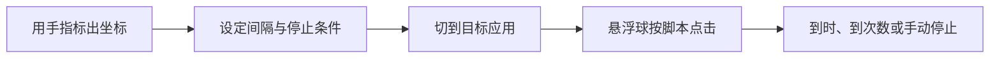
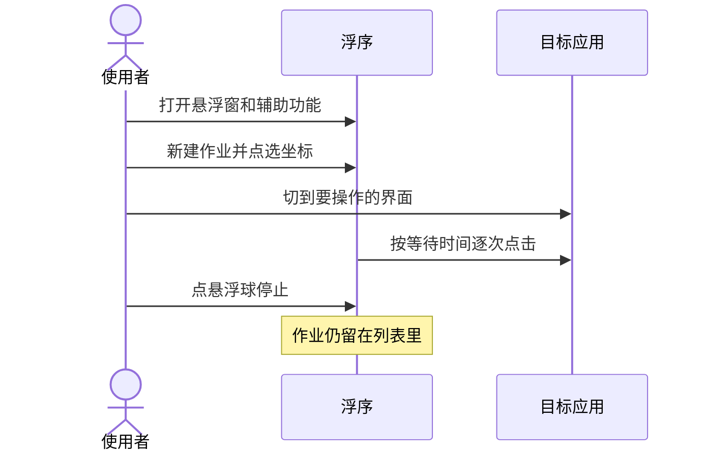
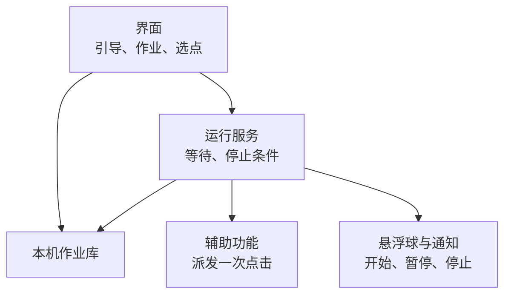

# 浮序 Floatap

在自己的安卓手机上，悬浮选定位置，按间隔、定时或顺序把点击做完。

本仓库目前是产品与设计文档，还没有应用代码。

## 它在做什么

点的位置由人指定。浮序不登录账号、不填写支付信息、不替用户下单。

## 文档

| | 文档 | 看什么 |
| --- | --- | --- |
| 01 | [应用蓝皮书](docs/01-应用蓝皮书.md) | 定位、场景、边界、路线图 |
| 02 | [产品需求分析](docs/02-产品需求分析.md) | 用户故事、功能编号、验收标准 |
| 03 | [产品设计开发文档](docs/03-产品设计开发文档.md) | 架构、状态机、脚本格式、里程碑 |

## 一次作业怎么跑

## 版本

图例：蓝是已经落地的范围，黄是紧接着要做的，灰是单独评审后再开工。

| 里程碑 | 交付 |
| --- | --- |
| M0 | 蓝皮书、需求、设计文档 |
| M1 | 悬浮球、手动选点、固定间隔、运行一段时间后停止 |
| M2 | 定时、随机间隔、多点顺序循环 |
| M3 | 导入导出、运行记录、像素颜色条件 |
| M4 | 局部画面匹配，以及如果 / 否则 |
| M5 | Windows 端读取同一份 JSON |

## 运行时各管一段

界面不直接点击。辅助功能不读作业库。调度只走运行服务。

## 使用边界

浮序只在用户已经授权的这台手机上点击。使用者自己遵守应用商店、游戏、票务平台的规则和当地法律。

| 会做 | 不做 |
| --- | --- |
| 悬浮在其他应用上 | 注入、root、Hook 其他进程 |
| 用户亲手标定的坐标 | 隐藏本应用、伪造输入来源 |
| 间隔、定时、顺序循环 | 对抗反作弊或安全软件 |
| 到时长或次数后停止 | 验证码破解、协议抢票、代抢 |
| 脚本留在本机 | 云端替别人点、批量控制多台设备 |
