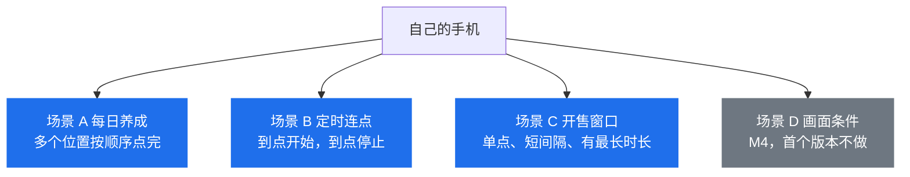
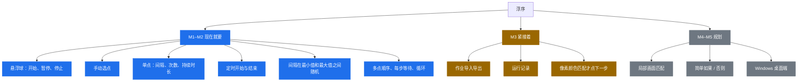
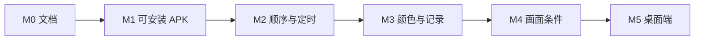

# 浮序 Floatap 应用蓝皮书

| 项 | 内容 |
| --- | --- |
| 产品名 | 浮序（英文代号 Floatap） |
| 文档版本 | 0.1 |
| 状态 | 立项文档，指导 M1–M5 |
| 首发平台 | Android APK |
| 后续平台 | Windows 桌面端，安卓主流程稳定后再启动 |

## 1. 一句话定义

浮序是装在用户自己手机上的悬浮连点工具：用户亲手标出要点的位置，设定间隔、定时和停止条件，让重复点击按脚本跑完。

## 2. 要解决的事

养成类游戏的每日任务、签到、重复对话，以及用户自己抢票时需要在固定区域连续点击，都是同一类动作：屏幕上几个点，按节奏点很多次。用人手点容易漏、容易点歪、也容易超时。

系统自带的「连点」通常只有固定频率，不能：

- 悬浮在别的应用上，并让用户用手指点选坐标
- 按顺序点多个位置并循环
- 在某个时钟或倒计时后开始、持续一段时间后自己停
- 把一套点击存成可复用的作业

浮序把这些收成一个本机脚本，而不是替用户登录、下单或操作账号。

## 3. 产品定位

| 维度 | 决定 |
| --- | --- |
| 谁在用 | 在自己手机上重复点击的个人用户 |
| 点哪里 | 只点用户手动标定的屏幕坐标，或以后由用户提供的局部画面样本触发 |
| 怎么点 | 安卓辅助功能里的手势派发，加上用户授予的悬浮窗 |
| 脚本存在哪 | 默认只在本机 |
| 商业形态 | 先做可安装的个人工具；收费、账号体系不在首期 |

首期成功的标准是：用户打开浮序，标一个点，设间隔和时长，切到目标应用后能按设定点击，并能随时停。

## 4. 明确不做

这些能力即使用户在抢票或游戏场景里用得上，也不进入设计和实现：

- 读取或填写其他应用里的账号、密码、支付信息
- 多开、改机、隐藏本应用、伪造输入来源，或针对某款反作弊、风控系统做规避
- root、注入、Hook 其他应用进程
- 验证码识别打码、协议层抢票、绕过票务或游戏的服务端校验
- 云端托管脚本替别人点击，或批量控制多台设备
- 在未获得悬浮窗、辅助功能授权时点击

随机间隔是给用户的时间参数（最小间隔到最大间隔之间取值），用来打散过于机械的固定节奏。它不是一套检测对抗模块，产品不提供「如何避开某应用检测」的策略或开关。

## 5. 目标用户与场景

图例：蓝色是 M1–M2 要走通的场景，灰色留到 M4。

### 5.1 用户

- 每天要在同一款游戏里点固定按钮的玩家
- 需要在开售时间段对购票页面的某个按钮连续点击的购票人
- 愿意自己看懂权限说明，并接受平台规则约束的人

不服务代抢、工作室批量控制和脚本售卖。

### 5.2 场景

**场景 A：每日养成**

用户标定「领取」「确认」「关闭」三个位置，每个位置有自己的等待时间，循环 1 次或数次。早上打开游戏，点一次开始，做完自动停。

**场景 B：定时连点**

用户设好坐标和间隔，选择开始时刻与结束时刻，或「开始后持续 N 分钟」。到点运行，到点停止。手机锁屏或用户摸屏幕时暂停，避免点到别的界面。

**场景 C：开售窗口里的单点连点**

用户提前标好按钮位置，用较短间隔连续点击，并设置最长运行时间，避免售罄后还在点。间隔可以在一个用户填写的范围内随机，避免每一次都是同一个毫秒数。

**场景 D（后期）：画面条件**

某个弹窗或按钮的局部画面出现时，才点击用户指定的位置。这是 M4，不进入首个可安装版本。

## 6. 产品原则

1. **点的位置由人指定。** 首期不猜测按钮在哪。
2. **运行状态随时可见、随时可停。** 悬浮球和通知栏都能停。
3. **权限只为点击和悬浮。** 不申请通讯录、短信、定位等无关权限。
4. **脚本可读。** 作业用一份人能打开的 JSON 描述，方便以后桌面端共用。
5. **失败要停在安全侧。** 权限被关、分辨率变了、用户正在触摸屏幕时，停止或暂停，不继续盲点。

## 7. 能力地图

图例与首页相同：蓝是当前范围，黄是下一迭代，灰是规划。

## 8. 和其他做法的差别

| 做法 | 浮序怎么处理 |
| --- | --- |
| 系统开发者选项里的显示点按 | 只用于用户自查，不作为产品能力 |
| 无障碍连点类应用 | 同类交互可以参考，浮序用自己的作业模型和停止条件 |
| 按图像找按钮的脚本工具 | 放到 M4，且样本必须由用户从自己的屏幕截取 |
| 协议脚本、抢票插件 | 不做 |

## 9. 成功标准

M2 结束时用这些指标判断能不能开始打磨，而不是用下载量：

| 指标 | 目标 |
| --- | --- |
| 冷启动到第一次成功连点 | 不看说明文档，3 分钟内完成授权、选点、开始、停止 |
| 点击落点 | 在用户标定的 48dp 点击热区内，连续 100 次不漂移出区 |
| 停止 | 点悬浮球停止后，下一次点击不再发出 |
| 时长停止 | 到达设定时长后 1 秒内停止 |
| 顺序作业 | 3 个点、每步不同等待，循环 5 次，顺序和次数与配置一致 |
| 权限回收 | 用户关掉辅助功能后，运行中的作业在下一次点击前停止并提示 |

## 10. 风险

| 风险 | 处理 |
| --- | --- |
| 应用商店把连点器视为违规工具 | 权限说明写清用途；安装包可先侧载。不在商店文案里承诺抢票成功或过检测 |
| 目标应用改版导致坐标失效 | 运行前记录屏幕宽高；尺寸变化时拒绝启动并要求重标 |
| 辅助功能被系统或厂商杀掉 | 前台服务 + 通知；被杀后状态改为已停止，不做保活黑科技 |
| 误点到支付、删除、授权弹窗 | 开始前倒计时；运行中检测到用户触摸则暂停；作业编辑页提示用户不要把点标在支付确认上 |
| 被用来违反平台规则 | 首次运行展示使用边界；产品不做规避检测的功能 |

## 11. 路线图

桌面端接在安卓顺序作业可用之后，不单独发明另一套脚本。

| 里程碑 | 交付 | 退出条件 |
| --- | --- | --- |
| M0 | 蓝皮书、需求、设计文档入库 | 三份文档可独立指导开发 |
| M1 | 可安装 APK：悬浮球、单点、固定间隔、时长停止 | 第 9 节里与单点相关的标准通过 |
| M2 | 定时、随机间隔、顺序循环、作业保存 | 场景 A 和场景 C 可完整走通 |
| M3 | 导入导出、运行记录、像素颜色条件 | 颜色不匹配时不点击 |
| M4 | 用户截取的局部画面匹配，以及顺序上的条件分支 | 单独评审后再开工 |
| M5 | Windows 端读取同一 JSON，完成单点与顺序作业 | 安卓 M2 已稳定使用 |

M5 的「推出桌面端」以安卓顺序作业可用为前提。桌面端不提前做一套不同的脚本语言。
