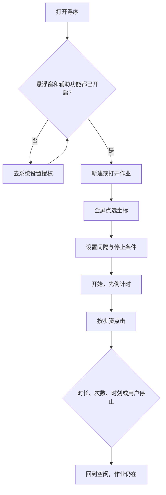
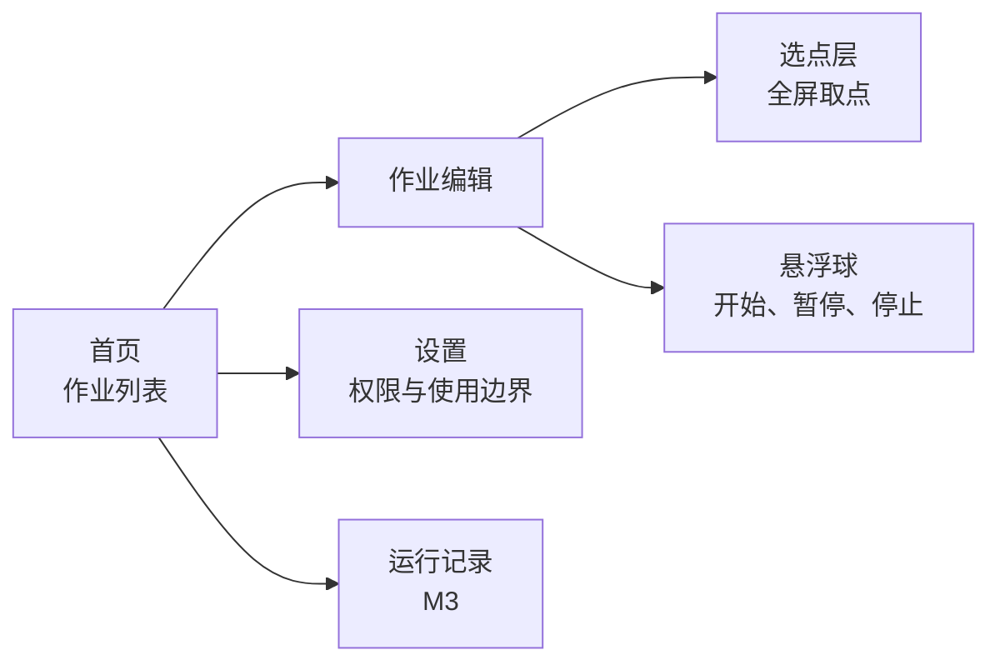

# 浮序 Floatap 产品需求分析

| 项 | 内容 |
| --- | --- |
| 文档版本 | 0.1 |
| 对应蓝皮书 | docs/01-应用蓝皮书.md |
| 需求状态 | M1、M2 为确认范围；M3 为下一迭代；M4 仅登记 |

优先级：P0 必须有才能发 M1/M2，P1 应有，P2 可延后。文中的「系统」都指浮序自己。

## 1. 角色

| 角色 | 说明 |
| --- | --- |
| 使用者 | 在本机授予悬浮窗和辅助功能，创建并运行作业 |
| 系统 | 保存作业、展示悬浮层、按脚本派发点击、到点停止 |

没有管理员、协作成员或云端账号。

## 2. 用户故事

| 编号 | 故事 | 优先级 |
| --- | --- | --- |
| US-01 | 作为使用者，我要让浮序浮在其他应用上，以便不用切回浮序就能开始和停止 | P0 |
| US-02 | 作为使用者，我要用手指点一下屏幕来记录坐标，以便不用手填像素 | P0 |
| US-03 | 作为使用者，我要设定每隔多久点一次，以便匹配按钮的刷新速度 | P0 |
| US-04 | 作为使用者，我要设定点击持续多久后自动停止，以便离开手机也不会一直点下去 | P0 |
| US-05 | 作为使用者，我要在任意时刻立刻停止，以便点错界面时能刹车 | P0 |
| US-06 | 作为使用者，我要在一个时间范围内随机等待再点下一次，以便节奏不是固定毫秒 | P0（M2） |
| US-07 | 作为使用者，我要在指定时刻开始，或在一个时间段内运行，以便对准开售或日常窗口 | P0（M2） |
| US-08 | 作为使用者，我要把多个位置按顺序点完并循环，每一步有自己的等待 | P0（M2） |
| US-09 | 作为使用者，我要保存多份作业并命名，以便游戏日常和抢票不用互相覆盖 | P1（M2） |
| US-10 | 作为使用者，我要在自己摸屏幕时暂停自动点击，以便临时操作 | P1 |
| US-11 | 作为使用者，我要导出作业再导入，以便换机 | P1（M3） |
| US-12 | 作为使用者，我要在某个像素颜色符合预期时才继续，以便界面还没出来时不乱点 | P1（M3） |
| US-13 | 作为使用者，我要在出现某块画面时点击指定位置，以便处理弹窗 | P2（M4，规划） |

## 3. 功能需求

### 3.1 权限与首次引导（P0）

**FR-01 引导**

首次打开依次说明：浮序会在其他应用上层显示一个小球；点击靠辅助功能完成；两项权限都由用户到系统设置里打开。

**FR-02 悬浮窗**

未授予 `SYSTEM_ALERT_WINDOW` 时，作业不能开始。界面给出前往系统设置的入口。

**FR-03 辅助功能**

未开启浮序的辅助功能服务时，作业不能开始。服务只声明执行手势所需能力，不读取窗口文字内容作为 M1/M2 的功能。

**FR-04 前台运行**

作业运行或等待定时触发期间，显示一条可持续存在的通知，通知上有「停止」。

### 3.2 选点（P0）

**FR-05 标定**

用户进入选点模式后，浮序盖住当前屏幕的透明层。用户点一次，记录该点的 x、y，以及当时的屏幕宽、高、方向。用户可拖动微调，确认后写入当前步骤。

**FR-06 多点**

一个作业包含有序步骤。M1 只编辑第 1 步。M2 可增删步骤、调整顺序。

**FR-07 分辨率变化**

开始运行时如果屏幕宽高或方向与标定时不一致，拒绝开始，并说明需要重新标定。不按比例静默换算后继续点。比例换算容易点偏，放到后续单独需求。

### 3.3 单点连点（P0，M1）

**FR-08 间隔**

每步有等待时间，单位毫秒。固定模式下，两次点击的间隔等于该等待。

允许范围：50ms 到 3,600,000ms。默认 500ms。低于 50ms 的值保存时改为 50ms 并提示。这是为了避免无意义的高频点击拖死辅助功能通道，不是速度优化指导。

**FR-09 停止条件**

每个作业至少启用一种停止条件，默认「持续时长 60 秒」：

- 持续时长：从第一次点击起算
- 总点击次数
- 循环次数（M2，顺序作业）
- 结束时钟（M2）

条件先到者生效。停止后不再派发下一次点击。

**FR-10 运行控制**

状态只有四种：未运行、等待定时、运行中、已暂停。

悬浮球提供开始、暂停、继续、停止。暂停保留进度（当前步骤和已点次数）。停止清掉本次进度，不删除作业。

**FR-11 开始倒计时**

开始后先倒计时 3 秒再点第一下，倒计时期间可取消。用户可在作业里把倒计时改成 0–10 秒。

### 3.4 随机间隔（P0，M2）

**FR-12 随机等待**

步骤的等待方式为「固定」或「区间」。区间保存最小值和最大值，且最小值 ≤ 最大值，两者都在 FR-08 的范围内。

每一次等待在闭区间内均匀随机取整毫秒。随机只决定下一次点击前的等待，不改变坐标，不改变是否发出点击。

产品界面把该选项称为「随机间隔」。不出现「防检测」「过检测」「伪装人工」之类文案。

### 3.5 定时（P0，M2）

**FR-13 开始时刻**

可选。未设置时，用户一点开始就进入倒计时。设置后，用户点开始进入「等待定时」，到时刻再倒计时并点击。

**FR-14 结束时刻**

可选。到达该本地时间后停止。若结束时刻不晚于开始时刻，保存时提示并拒绝保存。

**FR-15 等待期间**

等待定时时通知仍在，悬浮球显示等待中。用户可停止，停止后不再到点启动。

手机重启后不自动恢复作业。M2 不做开机自启。

### 3.6 顺序循环（P0，M2）

**FR-16 步骤**

步骤字段：顺序号、名称、坐标、屏幕宽高、等待方式、等待参数。M1/M2 的动作只有「点击一次」。

**FR-17 执行顺序**

运行从第 1 步到最后一步，每步先等待再点击。一轮结束后，若未达到循环次数且其他停止条件未满足，从第 1 步再来。

**FR-18 循环次数**

1 到 9999。另有「不限次数」，此时必须同时设置持续时长或结束时刻，否则拒绝保存。

**FR-19 空作业**

没有步骤，或某步没有坐标时，不能开始。

### 3.7 人为打断（P1）

**FR-20 用户触摸暂停**

作业可打开「触摸时暂停」，默认开。运行中如果辅助功能收到用户自己的触摸序列，暂停自动点击，悬浮球变为已暂停。不把用户的触摸当成脚本的一步。

该能力依赖系统是否把用户触摸回调给本服务。若某机型回调不到，设置页说明此开关可能无效，而不是改用别的方式去拦截全局触摸。

### 3.8 作业库（P1，M2）

**FR-21 作业**

作业有名称、更新时间、步骤、停止条件、定时、开始倒计时、触摸暂停开关。列表按更新时间倒序。

**FR-22 数量**

本地至少支持 50 个作业。超出时禁止新建并提示导出或删除。

### 3.9 像素颜色条件（P1，M3）

**FR-23**

步骤可附加一个条件：某个坐标的颜色与样本颜色的差值在容差内才允许点击。不匹配时按用户选择「跳过这一步」或「停止作业」。M3 之前的版本忽略该字段。

取色在用户标定当时完成，运行时重新读取该像素。读不到画面时停止并提示。

### 3.10 局部画面与条件逻辑（P2，M4，只登记）

**FR-24** 不在 M1–M3 实现。登记如下，避免以后脚本格式放不下：

- 用户从自己的截屏上框一块样本，样本只存在本机
- 运行时在用户划定的搜索区域内做模板匹配
- 匹配成功才执行该步点击，否则跳过或停止
- 步骤之间支持「如果匹配 / 否则」两路，不支持任意脚本代码

M4 开工前单独评审样本存储、性能和权限（是否需要录屏授权）。本文档不展开算法参数。

### 3.11 运行记录（P1，M3）

**FR-25**

每次运行结束后记一条：作业名、开始与结束时间、结束原因（用户停止、时长到、次数到、定时到、权限丢失、屏幕尺寸变化、颜色条件停止）、实际点击次数。只保留最近 100 条。

## 4. 非功能需求

| 编号 | 要求 |
| --- | --- |
| NFR-01 | 最低系统 Android 8.0（API 26）。开发用 Kotlin。界面用 Jetpack Compose |
| NFR-02 | 目标机为普通手机竖屏；M2 不承诺平板分屏和折叠屏外屏 |
| NFR-03 | 运行中除悬浮球和一条通知外，不抢焦点，不弹全屏 |
| NFR-04 | 作业与记录只存在应用私有目录。导出由用户主动分享文件 |
| NFR-05 | 无账号、无网络接口。M1–M3 安装包不申请 `INTERNET` |
| NFR-06 | 从停止指令到不再下发点击，目标不超过 1 秒 |
| NFR-07 | 简体中文界面。文案使用「作业」「步骤」「间隔」，不使用外挂、脚本挂、抢购成功等说法 |
| NFR-08 | 悬浮球可拖到四边，松手后贴边，避免挡住标定位置。位置记忆在本机 |

## 5. 主流程

### 5.1 第一次使用

1. 打开应用，阅读使用边界，点「继续」。
2. 按引导打开悬浮窗和辅助功能，返回后两项都显示已开启。
3. 新建作业，进入选点，在目标界面点一下并确认。
4. 间隔保持默认或自行修改，持续时长保持 60 秒。
5. 点开始，3 秒倒计时后开始点击。
6. 点悬浮球停止，通知消失，作业仍在列表里。

### 5.2 顺序作业

1. 在同一作业里添加步骤，每步单独选点并设置等待。
2. 设置循环次数，或改为不限次数并填写持续时长。
3. 开始后按步骤顺序执行，满足任一停止条件后结束。

### 5.3 定时

1. 填写开始时刻和结束时刻。
2. 点开始后进入等待，通知保持。
3. 到开始时刻后执行。到结束时刻、时长或次数时停止。

## 6. 界面需求（信息架构）

图例：运行记录是 M3 才有的入口。M1 必须有首页、编辑、选点、悬浮球和设置。

## 7. 业务规则汇总

| 规则 | 说明 |
| --- | --- |
| BR-01 | 两项权限缺一不可，否则不能开始 |
| BR-02 | 屏幕尺寸或方向与标定不一致时不能开始 |
| BR-03 | 不限次数时必须有持续时长或结束时刻 |
| BR-04 | 随机间隔的最小值不能大于最大值 |
| BR-05 | 结束时刻必须晚于开始时刻 |
| BR-06 | 停止优先于下一次点击 |
| BR-07 | 重启不恢复未完成的运行 |

## 8. 验收标准

### M1

- 未授权时开始按钮不可用，并能跳到对应系统设置。
- 选点后编辑页能看到坐标和标定时的屏幕宽高。
- 间隔 500ms、时长 10 秒的单点作业，实际点击次数在 18–21 次之间（含倒计时误差，不含倒计时本身）。
- 运行中点停止，之后 1 秒内无新点击。
- 关掉辅助功能后再点开始，不能开始。

### M2

- 区间 400–600ms 的作业，连续 20 次间隔都落在该区间，且不是 20 次全相同。
- 三步作业循环 2 次，点击顺序为 1-2-3-1-2-3。
- 开始时刻设为 1 分钟后，在此之前点击次数为 0，到时后才开始。
- 不限次数且没有时长和结束时刻时，无法保存。

### M3

- 颜色条件不满足且策略为停止时，该步及之后不再点击。
- 导出的文件可再导入，步骤与停止条件一致。

## 9. 需求头脑风暴（未承诺）

下列想法只作后备，不排进 M1–M3，除非单独改需求：

| 想法 | 为什么先不做 |
| --- | --- |
| 按比例把坐标换算到新分辨率 | 容易点偏，需要单独的预览确认 |
| 长按、滑动 | 动作模型会变，M2 只做单击 |
| 快捷设置磁贴 | 有悬浮球和通知后收益有限 |
| 深色主题 | 不挡主流程 |
| 桌面端热键 | 属于 M5 |
| 点击音效或振动反馈 | 容易干扰目标应用 |
| 多指同时点 | 场景不清晰，也更容易误触 |
| 根据通知内容触发 | 会读到其他应用的通知，超出范围 |
| 云同步 | 与无网络、无账号的决定冲突 |

可以放进 M3 附近、又不扩大权限的小项：运行结束振动一下、作业复制、步骤备注。这些在设计文档的里程碑里标成可选。
