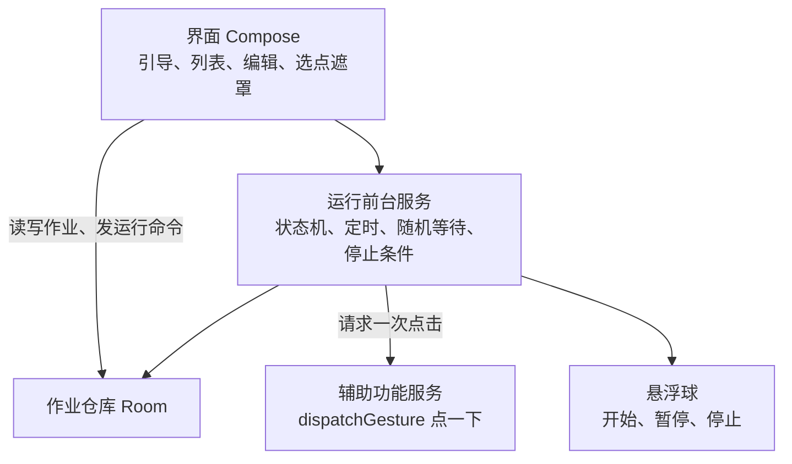
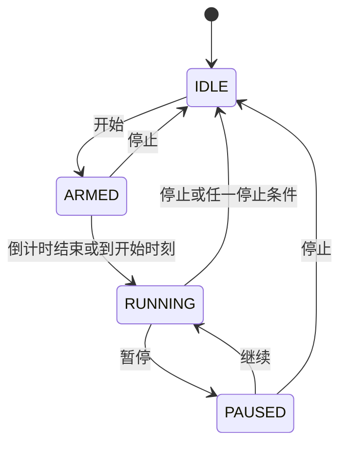

# 浮序 Floatap 产品设计开发文档

| 项 | 内容 |
| --- | --- |
| 文档版本 | 0.1 |
| 读者 | 实现 M1–M2 的开发与后续接手的人 |
| 平台 | Android 8.0+，语言 Kotlin，UI Jetpack Compose |
| 包名（拟定） | `app.floatap.android` |

桌面端在第 12 节只约定脚本兼容，不在本期写 Windows 工程。

## 1. 设计目标

把需求文档里的作业，变成一次只干一件事的运行循环：等到时间到了，就在用户标定的坐标上派发一次点击，然后看停止条件。

点击通过 `AccessibilityService.dispatchGesture` 完成。悬浮层只负责展示和接收用户对浮序自己的操作，不在其他应用上做无障碍节点遍历。M1/M2 不截屏、不读界面树。

## 2. 总体结构



图例：箭头是依赖方向。界面不调用辅助功能，辅助功能不读写数据库。

模块依赖是单向的：界面不直接调用辅助功能；辅助功能不读写数据库。运行服务是唯一调度者。

### 2.1 工程目录（M1 起按此创建）

```text
android/
  app/src/main/java/app/floatap/android/
    MainActivity.kt
    ui/            引导、列表、编辑、设置
    overlay/       悬浮球与选点遮罩
    engine/        状态机、等待、停止条件
    a11y/          AccessibilityService
    data/          Room 实体与仓库
    domain/        作业、步骤、运行状态
  app/src/main/res/
  app/src/test/    状态机与随机区间的单元测试
```

M0 只提交文档，不提前生成 Android 工程，避免空壳和文档脱节。M1 开工时再执行创建。

## 3. 领域模型

时间用本地时区的时分（定时）和毫秒时长（间隔、持续时长）。坐标是像素，整数，原点在屏幕左上角，与标定时的显示方向绑定。

```kotlin
enum class WaitMode { FIXED, RANGE }

enum class RunPhase { IDLE, ARMED, RUNNING, PAUSED }

enum class StopReason {
  USER, DURATION, CLICK_LIMIT, LOOP_LIMIT, SCHEDULE_END,
  PERMISSION, DISPLAY_CHANGED, COLOR_MISMATCH
}

data class Step(
  val id: Long,
  val order: Int,
  val name: String,
  val x: Int,
  val y: Int,
  val displayWidth: Int,
  val displayHeight: Int,
  val rotation: Int,
  val waitMode: WaitMode,
  val waitMinMs: Long,
  val waitMaxMs: Long
)

data class Job(
  val id: Long,
  val name: String,
  val steps: List<Step>,
  val durationMs: Long?,
  val clickLimit: Int?,
  val loopLimit: Int?,          // null 表示不限，此时 duration 或 scheduleEnd 必填
  val scheduleStartMinutes: Int?, // 从当天 0 点起的分钟，null 表示立即
  val scheduleEndMinutes: Int?,
  val countdownSec: Int,        // 0..10，默认 3
  val pauseOnUserTouch: Boolean
)
```

M3 再给 `Step` 增加可选的颜色条件，不改已有字段含义。

### 3.1 脚本 JSON

导出文件是一份 JSON，供 M3 导入导出和以后的桌面端读取。M2 可以先只存 Room，但字段名从一开始就按下面使用，避免两套名字。

```json
{
  "format": 1,
  "name": "每日领取",
  "countdownSec": 3,
  "pauseOnUserTouch": true,
  "durationMs": 60000,
  "clickLimit": null,
  "loopLimit": 1,
  "scheduleStart": null,
  "scheduleEnd": null,
  "steps": [
    {
      "name": "领取",
      "x": 540,
      "y": 1600,
      "displayWidth": 1080,
      "displayHeight": 2400,
      "rotation": 0,
      "wait": { "mode": "fixed", "minMs": 500, "maxMs": 500 }
    }
  ]
}
```

`format` 当前只允许 `1`。未知版本拒绝导入。`wait.mode` 为 `range` 时使用 `minMs` 与 `maxMs`。

## 4. 运行状态机



图例：`IDLE` 空闲，`ARMED` 等待定时或倒计时，`RUNNING` 正在点，`PAUSED` 暂停且不补点。

| 状态 | 行为 |
| --- | --- |
| IDLE | 不派发点击。悬浮球显示开始 |
| ARMED | 若有开始时刻且未到，挂一个闹钟到该时刻；否则做开始倒计时。此阶段点击次数为 0 |
| RUNNING | 取当前步骤的等待，到时检查停止条件，未停止则派发一次点击，步号前进 |
| PAUSED | 不再调度下一次等待。继续时从当前步重新等待，不补点暂停期间「错过」的次数 |

调度用运行服务里的一个协程完成，不用每步一个 `AlarmManager`。跨时刻的「开始时刻」用 `AlarmManager.setExactAndAllowWhileIdle` 把服务叫醒，因为等待可能超过数分钟，进程有可能被冻住。叫醒后如果作业已被用户停止，直接回到 IDLE。

### 4.1 单次循环

RUNNING 中每一步：

1. 计算等待毫秒。固定模式等于 `waitMinMs`。区间模式在 `[waitMinMs, waitMaxMs]` 上均匀随机，含两端。使用 `java.util.Random` 即可。
2. `delay` 该毫秒。delay 期间若阶段不再是 RUNNING，立刻退出，不点击。
3. 再次检查权限、屏幕宽高与方向、停止条件。
4. 向辅助功能服务提交一次点击手势，时长 1ms 的按下与抬起，坐标用该步的 x、y。
5. 点击计数加一。若本轮还有下一步，步号加一，否则步号回到 0 且循环计数加一。
6. 若任一停止条件已满足，阶段改为 IDLE，写入结束原因。

停止条件在点击前检查。因此「总点击次数 = 10」表示最多发出 10 次。

### 4.2 和用户触摸的关系

`pauseOnUserTouch` 为真时，辅助功能若收到非本服务发起的触摸开始事件，向运行服务发暂停。本服务自己派发的手势不应当被当成用户触摸；若个别机型分不清，M1 测试记录下来，M2 再决定是否默认关闭该开关。不额外申请能拦截全局触摸的能力。

## 5. 辅助功能服务

`AndroidManifest` 中注册服务，`android:exported="false"`。配套的 accessibility service 配置：

- 不请求 `flagRequestFilterKeyEvents`
- M1/M2 不请求截屏相关能力
- 反馈类型使用通用反馈
- 只在运行中的服务需要派发手势时工作

服务保持一个「当前是否允许派发」的标记，标记仅当运行服务处于 RUNNING 且本次请求带匹配的运行代号时为真。停止时先把标记关掉，再取消协程。这样队列里迟到的手势也不会再发出。

点击失败（手势被系统拒绝）时，运行服务停止作业，结束原因为 `PERMISSION`，通知里说明需要重新打开辅助功能。不自动重试一长串失败点击。

## 6. 悬浮层

两种窗口，不要叠在一起滥用：

| 窗口 | 何时显示 | 类型 |
| --- | --- | --- |
| 选点遮罩 | 用户在编辑页按下选点，直到确认或取消 | 全屏、可点、半透明 |
| 悬浮球 | 权限齐全后即可显示，运行时一定显示 | 小窗、可拖动、不获取输入法焦点 |

选点遮罩记录 `MotionEvent` 的原始坐标，同时用 `DisplayManager` 记下宽、高和旋转。确认后销毁遮罩，把结果交回编辑页。

悬浮球拖动阈值约 8dp：低于阈值视为点击，展开开始 / 暂停 / 停止；高于阈值视为拖动。松手后贴最近的左右边，y 保持在状态栏和导航栏之间。

窗口类型使用 `TYPE_APPLICATION_OVERLAY`。

## 7. 前台服务与通知

运行服务在进入 ARMED 或 RUNNING 时调用 `startForeground`。通知渠道「作业运行」，重要性为默认，避免无声到用户找不到停止入口，也不使用紧急级别。

通知动作只有「停止」。用户划掉通知时不结束作业（系统对前台通知的划掉行为不稳定），停止以通知按钮和悬浮球为准。

回到 IDLE 时 `stopForeground` 并停止服务。

## 8. 界面行为

### 8.1 首页

顶部标题「浮序」。主按钮「新建作业」。列表项显示名称、步骤数、上次更新时间。右上角进入设置。

没有作业时，空状态写明：先打开悬浮窗和辅助功能，再新建一个单点作业。

### 8.2 编辑页

- 名称，默认为「作业」加序号
- 步骤卡片：名称、坐标、等待。M2 起可添加步骤和排序
- 停止：持续时长、点击次数。M2 起加上循环次数
- M2 起：定时开始、定时结束、等待方式改为固定或区间
- 倒计时秒数
- 保存与开始

校验失败时，错误写在对应字段下，不使用只有一句「保存失败」的提示。

### 8.3 设置

两项权限各自显示已开启或未开启，未开启可跳转。另有使用边界全文，内容与蓝皮书第 4 节一致，用户可再次阅读。

### 8.4 文案约束

界面、通知、商店说明都不使用：外挂、防检测、过检测、稳定抢到、百分百。随机间隔的说明用：「每次等待在这两个时间之间随机取值」。

## 9. 数据存储

Room 数据库 `floatap.db`。

| 表 | 主要内容 |
| --- | --- |
| jobs | 作业级字段，定时与停止条件 |
| steps | jobId、顺序、坐标、屏幕、等待 |
| runs | M3 才建，运行记录 |

删除作业时级联删除步骤。运行中的作业禁止删除，编辑页说明需先停止。

不备份到应用的 `allowBackup` 以外的地方。`allowBackup` 设为 false，避免系统备份把点击坐标带出。用户要换机时走 M3 的导出文件。

## 10. 权限清单

| 权限 | 原因 |
| --- | --- |
| `SYSTEM_ALERT_WINDOW` | 悬浮球与选点遮罩 |
| 绑定辅助功能服务 | 派发点击手势 |
| `FOREGROUND_SERVICE` | 运行和等待定时期间保持调度 |
| `POST_NOTIFICATIONS` | Android 13+ 显示停止通知 |
| `SCHEDULE_EXACT_ALARM` 或 `USE_EXACT_ALARM` | 仅 M2 的开始时刻。优先使用能申请到的精确闹钟；申请不到时在界面说明定时可能延迟，并仍允许用户手动开始 |
| `WAKE_LOCK` 的部分唤醒 | 仅在等待间隔期间由前台服务持有短时唤醒，时长不超过当前这次 delay |

不申请：`INTERNET`、使用情况访问、通知监听、查询全部应用包、读取外部存储。选点不需要存储权限，因为不保存截图。

## 11. 错误与边界

| 情况 | 行为 |
| --- | --- |
| 等待期间用户停止 | 取消 delay，阶段 IDLE，不点击 |
| 屏幕旋转或分辨率变化 | 停止，原因 `DISPLAY_CHANGED` |
| 辅助功能被关 | 下一次派发前发现服务不在，停止 |
| 系统拒绝手势 | 停止，不连续重试 |
| 进程被杀 | 不恢复运行。用户重新打开后作业还在，状态为空闲 |
| 开始时刻已过 | 用户点开始时若时刻已过，提示改为立即开始或改时间，不静默等到第二天 |
| 区间最小值大于最大值 | 保存被拒绝 |

## 12. 测试

单元测试放在 `app/src/test`，不依赖模拟器和辅助功能：

- 停止条件：次数、时长、循环，谁先到
- 不限循环但没有时长和结束时刻时校验失败
- 区间随机：1000 次抽样全部落在闭区间内
- 停止后的迟到点击请求被标记拒绝
- JSON `format` 不为 1 时导入失败

M1 手工测试用一张全屏网格图（测试应用或静态壁纸）核对落点，记录机型、Android 版本、是否需要重新打开辅助功能。至少覆盖一台原生系统或接近原生的手机，以及一台国产桌面手机。

自动化 UI 测试不作为 M1 门槛。辅助功能手势在仪器测试里不稳定，落点以手工网格为准。

## 13. 里程碑任务

### M1

1. 空工程：Compose、单 Activity、minSdk 26、无 INTERNET
2. 引导页与两项权限检测
3. Room 保存只有一个步骤的作业
4. 选点遮罩
5. 辅助功能服务派发单次点击
6. 运行服务：固定间隔、持续时长、倒计时、停止
7. 悬浮球与前台通知
8. 按需求文档 M1 验收标准自测

### M2

1. 多步骤与循环
2. 区间等待
3. 开始与结束时刻
4. 作业列表的增删改
5. 按需求文档 M2 验收标准自测

### M3 及以后

像素条件、导入导出、运行记录按需求文档做。M4 图像匹配和 M5 桌面端各自另写一节设计补遗后再写代码。

桌面端预留约定：读取 `format: 1` 的 JSON；Windows 上的点击实现换成该平台的输入 API；停止条件与步骤语义保持一致。不在安卓工程里提前抽象一套跨平台框架。

## 14. 发布注意

- 版本号从 `0.1.0` 起，M1 可安装包用这个版本
- 签名密钥不进仓库
- 发布说明写权限用途和停止方法
- 不在发布说明里举具体游戏或票务 App 的「过检测」例子

## 15. 实现时的取舍

| 选择 | 原因 |
| --- | --- |
| 单击手势，不做滑动 | 覆盖需求里的连点与顺序点击 |
| 尺寸不一致就拒绝运行 | 比静默缩放安全，失败可见 |
| 重启不续跑 | 避免用户不知情时在错误界面点击 |
| 无网络 | 缩小权限和数据离开本机的路径 |
| 随机只作用在等待时间上 | 满足间隔可配置，同时不引入隐藏或伪造输入的设计 |
