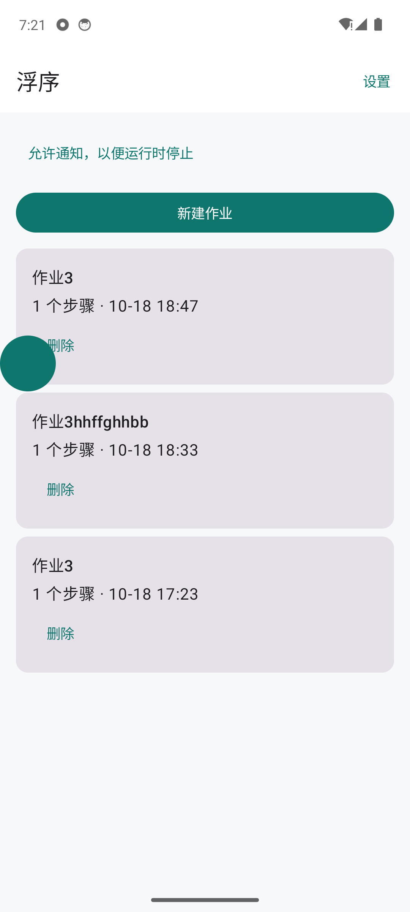
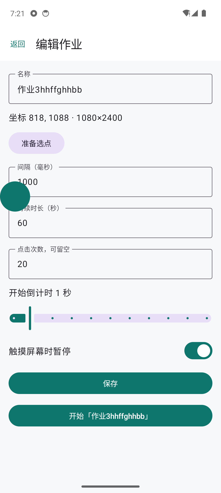
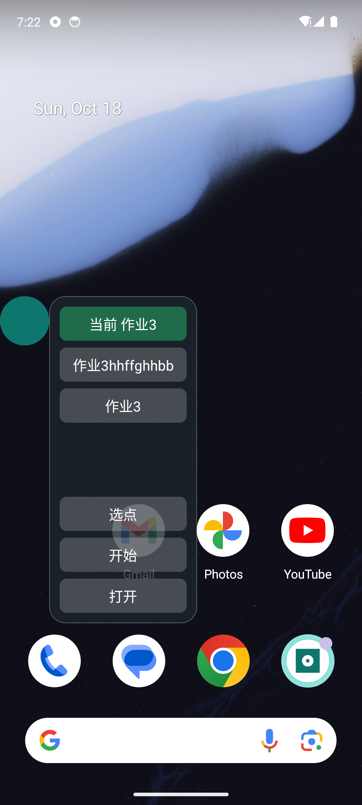

# 浮序 1.0.0

1.0.0 是第一版正式包，只做单点连点。定时、多点顺序和画面匹配留到后面的版本。

安装包：[floatap-1.0.0.apk](https://github.com/Armstrong2015/floatap/releases/download/v1.0.0/floatap-1.0.0.apk)

如果手机上还装着以前的调试包，先卸载再装。正式包的签名和调试包不同，不能直接覆盖。装好后重新打开悬浮窗和辅助功能。

## 这一版能做什么

- 新建作业，给它起名，并保存在手机里
- 在其他应用的画面上选一个点
- 按固定间隔重复点击这个点
- 开始前有 0–10 秒倒计时，用来切到要点的应用
- 到达设定的时长或点击次数后停止
- 悬浮球里切换作业、选点、开始、暂停、停止
- 打开「触摸屏幕时暂停」后，手指点到屏幕其他地方会暂停；关掉后，点屏幕不会把这次运行停掉

浮序只点击你亲手标出的坐标。它不读取其他应用里的文字，也不登录账号。

## 第一次要打开的权限

1. 打开浮序，点右上角「设置」。
2. 按提示打开「显示在其他应用的上层」（悬浮窗）。
3. 再打开辅助功能里的「浮序」。系统会说明这项权限用来在你标定的位置上点击。
4. 回到浮序。如果列表上方写着「允许通知，以便运行时停止」，按系统提示允许通知。运行中的通知可以用来查看状态，通知上的「停止」也能结束这次运行。

权限是系统界面里的开关，不在作业配置页里。换一部手机，或卸载重装之后，这两项要重新打开。

## 配置一份作业

打开浮序，点「新建作业」，或点列表里已有的作业进入「编辑作业」。

配置页从上到下是：

| 项目 | 怎么填 |
| --- | --- |
| 名称 | 用来在悬浮球里认出这份作业 |
| 准备选点 | 还没有坐标时，先点这里。应用会收成屏幕边缘的圆点 |
| 间隔（毫秒） | 两次点击之间固定等待多久。1.0.0 每次都是这一个数。小于 50 毫秒会在保存时改成 50 毫秒 |
| 持续时长（秒） | 从第一次点击开始算，到时间就停止 |
| 点击次数 | 点满这个次数就停止。可以留空，这时必须填写持续时长 |
| 开始倒计时 | 0–10 秒。用来从浮序切到要点的应用 |
| 触摸屏幕时暂停 | 打开后，手指碰到屏幕其他位置就暂停。点悬浮球本身不会被当成这次暂停 |

持续时长和点击次数至少填一项，避免作业一直点下去。

### 选点

1. 在配置页点「准备选点」。浮序收到边缘，变成一颗圆点。
2. 打开要操作的应用，把按钮留在屏幕上。
3. 点圆点，在菜单里点「选点」。
4. 画面会略微变暗。点你要连点的位置。坐标记到当前这份作业里，不会再打开配置页。
5. 圆点上有「取消选点」。如果它挡住了目标，按住圆点拖开再点。

选点时不要站在系统「设置」里，那一页会把悬浮窗藏起来。用时钟、浏览器或其他普通应用来选。

## 开始、暂停和停止

点圆点，菜单里列出已保存的作业。绿色的一行是当前作业。

- 「选点」给当前作业换坐标
- 「开始」按当前作业的间隔和停止条件运行
- 「打开」回到这份作业的配置页
- 运行中再点圆点，菜单变成「暂停」和「停止」。暂停后再点圆点，可以「继续」
- 圆点的颜色：青色是空闲，蓝色是正在点击，灰色是已暂停

开始之后先等倒计时结束，再点第一下。倒计时期间可以从最近任务切到目标应用。每次点击会在落点闪一下圆圈，用来确认确实点到了。

到时长或到次数后，圆点回到青色，屏幕上会留下停止原因，例如「到达点击次数，已停止」。

## 和后面版本的差别

1.0.0 的间隔是一个固定毫秒数。随机间隔、定时启动和多个点按顺序点击不在这一版里。
